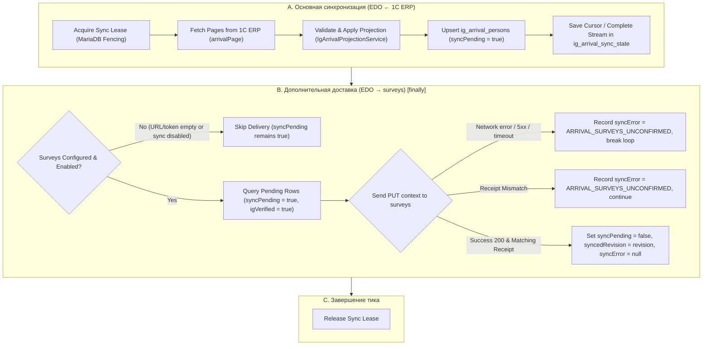

# FIX-07 — Устранение обязательной зависимости EDO от surveys

> **For agentic workers:** REQUIRED SUB-SKILL: Use superpowers:subagent-driven-development (recommended) or superpowers:executing-plans to implement this plan task-by-task. Steps use checkbox (`- [ ]`) syntax for tracking.

**Goal:** Устранить блокирующую зависимость основного процесса синхронизации заездов кандидатов (EDO ← 1С ERP) от второстепенного интеграционного сервиса surveys-service ЛК, разделив основную синхронизацию и опциональную доставку контекста адаптации, а также исключив технические ошибки surveys из операторской очереди `needsAttention`.

**Architecture:** 
1. Первичная синхронизация EDO ← 1С ERP выполняется безусловно и независимо от наличия конфигурации или доступности surveys-service.
2. Вторичная доставка контекстов EDO → surveys выносится в завершающий этап (выполняется в `finally` воркера), при отсутствии конфигурации или выключении `EDO_ADAPTATION_SYNC_ENABLED` доставка корректно пропускается, при сбоях сети/HTTP 500 попытки прерываются для экономии дедлайна без отмены статуса ожидания (`syncPending: true`).
3. В `env.validation.ts` параметры surveys (`EDO_ARRIVAL_CONTEXTS_URL`, `EDO_ADAPTATION_SYNC_TOKEN`) становятся опциональными для `EDO_ARRIVAL_SYNC_ENABLED=true` (обязателен только источник `ERP_COMMUNICATIONS_URL`).
4. В `IgArrivalQueueService` техническое поле `p.syncError` исключается из условия `problem` и расчёта `needsAttention`/`issues`, а в `issueCode` возвращается только реальная бизнес-проблема.

**Tech Stack:** NestJS, TypeScript, MariaDB (Prisma), Vitest.

---



---

## User Review Required

> [!NOTE]
> В `apps/api/src/config/env.validation.ts` при `EDO_ARRIVAL_SYNC_ENABLED === 'true'` ранее требовались `EDO_ARRIVAL_CONTEXTS_URL` и `EDO_ADAPTATION_SYNC_TOKEN`. Это блокировало запуск приложения, если surveys не был настроен. Теперь обязателен только `ERP_COMMUNICATIONS_URL` (источник заездов). Если `EDO_ARRIVAL_CONTEXTS_URL` передан, он по-прежнему строго валидируется на валидность URL и HTTPS в production.

> [!IMPORTANT]
> `p.syncError` в таблице `ig_arrival_persons` сохраняется в БД для технической диагностики и логов, но больше не переводит кандидата в статус `needsAttention` в очереди оператора EDO. Оператор видит только реальные бизнес-проблемы (конфликты, незаполненные поля заезда, возвращённые документы, ошибки отправки в 1С).

---

## Open Questions

Нет блокирующих вопросов. Требования спецификации FIX-07 полностью определены.

---

## Proposed Changes

### Component: API Configuration (`apps/api/src/config`)

#### [MODIFY] [env.validation.ts](file:///home/tixlag/orca/projects/edo.sps38.pro/apps/api/src/config/env.validation.ts)
- Сделать `EDO_ARRIVAL_CONTEXTS_URL` и `EDO_ADAPTATION_SYNC_TOKEN` необязательными при `EDO_ARRIVAL_SYNC_ENABLED === 'true'`.
- Оставить обязательным только `ERP_COMMUNICATIONS_URL`.
- Если `EDO_ARRIVAL_CONTEXTS_URL` задан — проверять его корректность (URL, путь `/surveys-service/api/internal/edo/arrival-contexts`, HTTPS в production).

```typescript
// apps/api/src/config/env.validation.ts
  if (parsed.EDO_ARRIVAL_SYNC_ENABLED === 'true' && !parsed.ERP_COMMUNICATIONS_URL) {
    throw new Error('ERP_COMMUNICATIONS_URL is required when EDO_ARRIVAL_SYNC_ENABLED=true');
  }
  if (parsed.EDO_ARRIVAL_SYNC_ENABLED === 'true' && parsed.EDO_ARRIVAL_CONTEXTS_URL) {
    const url = new URL(parsed.EDO_ARRIVAL_CONTEXTS_URL);
    if (url.username || url.password || url.search || url.hash || url.pathname !== '/surveys-service/api/internal/edo/arrival-contexts' || (url.protocol !== 'https:' && !(url.protocol === 'http:' && parsed.NODE_ENV !== 'production'))) {
      throw new Error('EDO_ARRIVAL_CONTEXTS_URL must be the approved Surveys endpoint over HTTPS in production');
    }
  }
```

---

### Component: Documents & Arrival Synchronization (`apps/api/src/documents`)

#### [MODIFY] [ig-arrival-sync.worker.ts](file:///home/tixlag/orca/projects/edo.sps38.pro/apps/api/src/documents/ig-arrival-sync.worker.ts)
- В методе `run()`:
  - Удалить безусловный вызов `await this.deliverPending(deadline);` перед циклом чтения страниц ERP.
  - Основной цикл чтения страниц из 1С ERP запускается первым и выполняется независимо от surveys.
  - Доставка `deliverPending(deadline)` вызывается в блоке `finally` как вторичная операция.
- В методе `deliverPending(deadline)`:
  - Проверять `EDO_ADAPTATION_SYNC_ENABLED`: если `=== 'false'`, немедленно выходить (`return`).
  - Проверять наличие `endpoint` и `token`: если не заданы или пустые, немедленно выходить (`return`), не выбрасывая исключение `ARRIVAL_SYNC_NOT_CONFIGURED`.
  - При невалидном URL логировать предупреждение и выходить (`return`), не выбрасывая ошибку наружу.
  - При сетевой ошибке/таймауте `fetch` (сервис выключен/недоступен): обновлять текущую строку `syncError: "ARRIVAL_SURVEYS_UNCONFIRMED"`, логировать и делать `break`, чтобы не расходовать дедлайн синхронизации.
  - При HTTP `>= 500`: обновлять строку `syncError: "ARRIVAL_SURVEYS_UNCONFIRMED"`, логировать и делать `break`.
  - При несовпадении квитанции или невалидном ответе: фиксировать `syncError: "ARRIVAL_SURVEYS_UNCONFIRMED"` для текущей строки и продолжать цикл со следующей строкой.
  - При успешном подтверждении (200 + валидный receipt): сбрасывать `syncPending = false`, `syncedRevision = row.revision`, `syncError = null`.

#### [MODIFY] [ig-arrival-queue.service.ts](file:///home/tixlag/orca/projects/edo.sps38.pro/apps/api/src/documents/ig-arrival-queue.service.ts)
- Исключить `p.syncError IS NOT NULL` из условия `const problem`:
```typescript
const problem = Prisma.sql`(p.state = 'CONFLICT' OR ${sourceIssue} OR p.bindingError IS NOT NULL OR c.igRequirementsConflict = 1 OR m.arrivalDate IS NULL OR m.locationUid IS NULL OR ${returned} OR ${deliveryProblem})`;
```
- В запросе `people` заменить `ELSE p.syncError END AS issueCode` на `ELSE NULL END AS issueCode`, чтобы технические ошибки surveys не становились кодами бизнес-проблем кандидата.

---

### Component: Automated Tests (`apps/api/test`)

#### [MODIFY] [env-validation.spec.ts](file:///home/tixlag/orca/projects/edo.sps38.pro/apps/api/test/env-validation.spec.ts)
- Обновить тесты валидации окружения:
  - Проверять, что `EDO_ARRIVAL_SYNC_ENABLED=true` требует `ERP_COMMUNICATIONS_URL`, но НЕ требует `EDO_ARRIVAL_CONTEXTS_URL` и `EDO_ADAPTATION_SYNC_TOKEN`.
  - Проверять, что валидация формата `EDO_ARRIVAL_CONTEXTS_URL` срабатывает, когда он передан.

#### [MODIFY] [ig-arrival-sync.spec.ts](file:///home/tixlag/orca/projects/edo.sps38.pro/apps/api/test/ig-arrival-sync.spec.ts)
- Добавить тесты для сценариев FIX-07:
  - **Тест 1 (Surveys не настроен):** При пустых `EDO_ARRIVAL_CONTEXTS_URL` и `EDO_ADAPTATION_SYNC_TOKEN` и `EDO_ADAPTATION_SYNC_ENABLED=false` заезд успешно загружается из ERP, сохраняется в EDO, кандидат создаётся/связывается, `syncPending = true`, ошибок не возникает.
  - **Тест 2 (Surveys недоступен):** При падении `fetch` (network error / HTTP 500) страницы ERP продолжают синхронизироваться, `syncPending = true`, `syncError = "ARRIVAL_SURVEYS_UNCONFIRMED"`, воркер не падает.
  - **Тест 3 (Surveys восстановился):** После сбоя сервис отвечает 200 с квитанцией — контекст успешно подтверждается, `syncPending` сбрасывается в `false`, `syncedRevision` фиксируется, `syncError = null`.
  - **Тест 4 (Обновление заезда):** При изменении заезда в ERP новая ревизия сохраняется в EDO независимо от доступности surveys; после восстановления surveys передаётся актуальная ревизия.

#### [MODIFY] [ig-arrival-queue.spec.ts](file:///home/tixlag/orca/projects/edo.sps38.pro/apps/api/test/ig-arrival-queue.spec.ts)
- Добавить тест сценария:
  - **Тест 5 (Операторская очередь):** Кандидат с непустым `syncError` (например, `ARRIVAL_SURVEYS_UNCONFIRMED`), но без бизнес-проблем, возвращает `needsAttention: false`, `issueCode: null`, и не увеличивает счётчик `issues`/`needsAttention` в группах.

---

## Detailed Task Breakdown

### Task 1: Environment Validation Update
**Files:**
- Modify: `apps/api/src/config/env.validation.ts:86-94`
- Modify: `apps/api/test/env-validation.spec.ts:22-45`

- [ ] **Step 1: Update `env.validation.ts`**
  Сделать surveys параметры опциональными при `EDO_ARRIVAL_SYNC_ENABLED=true`, требуя только `ERP_COMMUNICATIONS_URL`.
- [ ] **Step 2: Update `env-validation.spec.ts`**
  Обновить тесты на требование `ERP_COMMUNICATIONS_URL` и опциональность surveys.
- [ ] **Step 3: Run env validation tests**
  `pnpm --filter @edo/api test test/env-validation.spec.ts`

### Task 2: Decouple Arrival Sync Worker from Surveys
**Files:**
- Modify: `apps/api/src/documents/ig-arrival-sync.worker.ts:75-77, 187-202, 357-468`
- Modify: `apps/api/test/ig-arrival-sync.spec.ts`

- [ ] **Step 1: Write unit tests in `ig-arrival-sync.spec.ts`**
  Покрыть тестами: не настроен surveys, surveys оффлайн / 500, surveys восстановился, обновление ревизии.
- [ ] **Step 2: Update `IgArrivalSyncWorker`**
  - Убрать `await this.deliverPending(deadline)` из начала `run()`.
  - Обновить `deliverPending`:
    - early return при отключенном adaptation sync или отсутствующих endpoint/token;
    - early return при невалидном URL (с предупреждением в лог);
    - break из цикла при network error / HTTP 500;
    - сохранение `syncError: "ARRIVAL_SURVEYS_UNCONFIRMED"` и `syncPending: true` при любых сбоях подтверждения;
    - сброс `syncPending: false`, `syncError: null`, `syncedRevision: row.revision` при успешном подтверждении.
- [ ] **Step 3: Run arrival sync tests**
  `pnpm --filter @edo/api test test/ig-arrival-sync.spec.ts`

### Task 3: Disentangle Operator Queue from Surveys Technical Errors
**Files:**
- Modify: `apps/api/src/documents/ig-arrival-queue.service.ts:56, 166`
- Modify: `apps/api/test/ig-arrival-queue.spec.ts`

- [ ] **Step 1: Write unit test in `ig-arrival-queue.spec.ts`**
  Проверить, что `p.syncError` не создаёт `needsAttention: true` и не выставляется в `issueCode` при отсутствии бизнес-проблем.
- [ ] **Step 2: Update `IgArrivalQueueService`**
  - Удалить `p.syncError IS NOT NULL` из SQL `problem`.
  - Заменить `ELSE p.syncError END` на `ELSE NULL END` в `issueCode`.
- [ ] **Step 3: Run arrival queue tests**
  `pnpm --filter @edo/api test test/ig-arrival-queue.spec.ts`

### Task 4: Full Validation & Linting
- [ ] **Step 1: Run all arrival-related tests**
  `pnpm --filter @edo/api test test/ig-arrival-contract.spec.ts test/ig-arrival-queue.spec.ts test/ig-arrival-sync.spec.ts test/env-validation.spec.ts`
- [ ] **Step 2: Run all API tests**
  `pnpm --filter @edo/api test`
- [ ] **Step 3: Run TypeScript build & lint**
  `pnpm --filter @edo/api build`
  `pnpm lint`

### Task 5: Documentation & Git Commit
- [ ] **Step 1: Check diff against HEAD**
  `git diff 0b55c7593ce10bd8dc7964aa77a31086dc18ddb8`
- [ ] **Step 2: Create commit `fix(arrival): decouple arrival synchronization from surveys service (FIX-07)`**
- [ ] **Step 3: Push to `origin` and `gitlab` branch `fix/ig-erp-confirmed-delivery`**
- [ ] **Step 4: Verify MR !50 status**

---

## Verification Plan

### Automated Tests
```bash
# 1. Запуск целевых тестов синхронизации и очередей
pnpm --filter @edo/api test test/env-validation.spec.ts test/ig-arrival-sync.spec.ts test/ig-arrival-queue.spec.ts

# 2. Запуск полного набора тестов API
pnpm --filter @edo/api test

# 3. Компиляция и линтинг
pnpm --filter @edo/api build
pnpm lint
```

### Manual Verification & Local Testing with ERP_Noskov

Для проверки работы EDO исключительно с 1C ERP (`ERP_Noskov`) без запуска surveys:

1. В корневом `.env`:
```dotenv
# Основная синхронизация EDO <- 1C ERP
EDO_ARRIVAL_SYNC_ENABLED=true
ERP_COMMUNICATIONS_URL=http://<host-erp>/ERP_Noskov/hs/edo/v1
ERP_COMMUNICATIONS_TOKEN=<token>

# Вторичная интеграция с surveys полностью отключена
EDO_ADAPTATION_SYNC_ENABLED=false
EDO_ARRIVAL_CONTEXTS_URL=
EDO_ADAPTATION_SYNC_TOKEN=
```

2. Запуск EDO:
```bash
# Проверка и миграция БД
pnpm db:migrate

# Запуск API и Web
pnpm dev
```

3. Ожидаемый результат:
- Приложение запускается без ошибок валидации env.
- В логах API воркер `IgArrivalSyncWorker` успешно опрашивает ERP `arrivalPage`, сохраняет участников заездов в MariaDB.
- В веб-интерфейсе EDO по адресу `/review/ig/arrivals` открывается группированная очередь заездов.
- Участники без бизнес-проблем отображаются в своих группах заезда со статусом `Ожидание документов` или `На проверке`, без ложного предупреждения `Требует внимания`.
