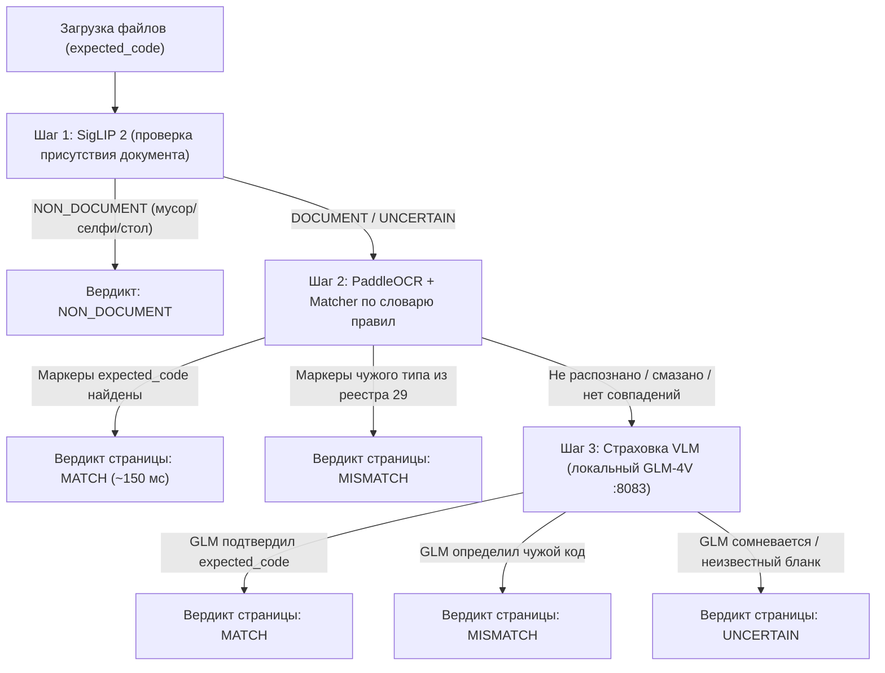

# Дизайн системы проверки типов документов (OCR Document Type Verification)

**Дата:** 2026-11-03  
**Статус:** Согласовано  
**Область:** `ocr/` (FastAPI, PaddleOCR, SigLIP 2, GLM-4V), `apps/api` (NestJS, OcrWorkerService, ExternalOcrService), `packages/api-client`, `apps/web` (карточка проверки).

---

## 1. Контекст и цели

### Проблема
В настоящее время сервис проверки изображений (`POST /document-check` на порту 8000) выполняет только бинарную проверку: присутствует ли на изображении документ или не-документ (кошка, собака, еда, пустой рабочий стол) с помощью модели `google/siglip2-base-patch16-224`.
Если кандидат загружает **ИНН вместо Паспорта** или **СНИЛС вместо Водительского удостоверения**, модель `SigLIP 2` классифицирует изображение как `DOCUMENT`. В результате:
1. Запускается извлечение полей чужого документа (например, поиск полей паспорта РФ на бланке ИНН), что приводит к сбоям OCR либо мусорным значениям.
2. Для документов без профиля распознавания полей (ИНН, СНИЛС, дипломы) документ без предупреждений переходит в статус `IN_REVIEW`, перекладывая выявление очевидных ошибок на оператора.

### Цель
Обеспечить автоматическую валидацию типа загружаемого документа на соответствие ожидаемому коду (`expected_code` / `documentTypeCode`) для **29 базовых типов документов** и предусмотреть простое расширение на новые типы без переобучения нейросетей.

---

## 2. Архитектура решения

Реализуется **двухступенчатый гибридный пайплайн**:



### Преимущества подхода:
1. **Скорость:** 80–90% стандартных читаемых документов подтверждаются за 100–150 мс через быстрый `PaddleOCR` без нагрузки на VLM.
2. **Точность:** Спорные, нестандартные или рукописные бланки страхуются мультимодальной моделью `GLM-4V` (порт 8083).
3. **Масштабируемость:** Добавление новых типов документов осуществляется декларативно через JSON-словарь правил без сбора датасетов и обучения нейросетей.

---

## 3. Список поддерживаемых документов (29 типов)

1. **Личность и миграция:**
   * Паспорт
   * Вид на жительство
   * Миграционная карта
   * Патент на работу
   * Регистрация
   * Перевод паспорта (для ИГ)
   * Сертификат Русский язык
2. **Госучет, налоги, воинский учет:**
   * ИНН
   * СНИЛС
   * Военный билет
   * Справка об отсуствие судимости
3. **Вождение, спецтехника, допуски:**
   * Водительское удостоверение
   * Карта тахографа
   * ДОПОГ
   * НАКС
   * Удостоверение машинист экскаватора
   * Защитное, Зимнее вождение
   * Свидетельство о профессии
4. **Образование:**
   * Диплом о высшем образовании
   * Диплом о профессиональной переподготовки
   * Диплом/св-во о начальном профессиональном образовании
5. **Медицинские документы:**
   * Заключение обязательного психиатрического освидетельствования
   * Медицинское освидетельствование ИГ
   * Справка антитела КОРЬ
   * Страховой полис
6. **Гражданское состояние, стаж, финансы:**
   * Св-во о браке
   * Св-во о рождении ребенка
   * Реквизиты банка
   * Трудовая книжка

---

## 4. Спецификация контрактов API

### 4.1. Конфиг правил: `ocr/contracts/document-type-rules.json`
Декларативное описание признаков для каждого документа:
```json
{
  "version": "document-type-rules-v1",
  "rules": [
    {
      "code": "INN",
      "title": "ИНН",
      "aliases": ["свидетельство инн", "инн физического лица"],
      "markers": [
        "свидетельство о постановке на учет",
        "налогоплательщик",
        "идентификационный номер налогоплательщика"
      ],
      "patterns": ["\\b\\d{12}\\b"],
      "min_markers": 1
    },
    {
      "code": "SNILS",
      "title": "СНИЛС",
      "aliases": ["страховое свидетельство", "ади-рег", "страховой номер"],
      "markers": [
        "страховое свидетельство",
        "пенсионного страхования",
        "страховой номер индивидуального лицевого счета",
        "ади-рег",
        "сфр",
        "пфр"
      ],
      "patterns": ["\\b\\d{3}-\\d{3}-\\d{3}\\s*\\d{2}\\b"],
      "min_markers": 1
    }
  ]
}
```

### 4.2. Эндпоинт проверки: `POST /document-check` (порт 8000)
**Параметры запроса (Multipart Form Data):**
* `files`: один или несколько файлов (изображения JPG/PNG/WebP, многостраничные PDF).
* `expected_code` (строка, опционально): системный код ожидаемого типа документа (`"INN"`, `"PASSPORT"`, `"SNILS"`, `"ERP_<uid>"` и т.д.).

**Схема ответа (`document-check-v2`):**
```json
{
  "policy_version": "document-check-v2",
  "presence": "DOCUMENT",
  "type_verdict": "MATCH",
  "expected_code": "INN",
  "detected_code": "INN",
  "expected_title": "ИНН",
  "detected_title": "ИНН",
  "rejection_reason": null,
  "source": "PADDLE_RULES",
  "pages": [
    {
      "page_number": 1,
      "presence": "DOCUMENT",
      "type_verdict": "MATCH",
      "detected_code": "INN",
      "confidence": 0.98,
      "matched_phrases": ["свидетельство о постановке на учет", "инн"]
    }
  ],
  "elapsed_ms": 142.5
}
```

**Значения `type_verdict`:**
* `MATCH` — подтверждено соответствие ожидаемому коду документа.
* `MISMATCH` — на фото обнаружен совершенно другой документ (заполняются `detected_code`, `detected_title` и `rejection_reason`).
* `UNCERTAIN` — нет уверенного подтверждения или опровержения (авто-отказ не выставляется).

### 4.3. Правило объединения страниц для многостраничных документов
* Если **хотя бы одна** страница пакета получила `MATCH` $\rightarrow$ итоговый вердикт пакета: **`MATCH`**.
* Если **ни на одной** странице нет `MATCH`, но зафиксирован `MISMATCH` (и нет ни одной страницы со статусом `UNCERTAIN`) $\rightarrow$ итоговый вердикт: **`MISMATCH`**.
* Если нет `MATCH`, но есть страницы со статусом `UNCERTAIN` $\rightarrow$ итоговый вердикт: **`UNCERTAIN`**.

---

## 5. Интеграция с бэкендом ЭДО и логика попыток

### 5.1. Поведение `OcrWorkerService`

1. **`type_verdict === "MISMATCH"`:**
   * Проверяется количество предыдущих авто-отказов (`previous.length < 2`):
     * **Попытки 1 и 2:** перевод `DocumentVersion` в статус `RETURNED`. Записывается понятная кандидату причина отказа:  
       *«Загружен документ "{detected_title}" вместо ожидаемого "{expected_title}". Пожалуйста, прикрепите корректный файл.»*  
       Поле `reviewedBy: "ocr-document-check"`.
     * **Попытка 3 (лимит авто-отказов):**  
       Документ **не** отклоняется. Переводится в статус `IN_REVIEW`. В `ocrRaw` выставляются флаги:
       `automaticReturnLimitReached: true` и `typeMismatchWarning: { expected: expected_code, detected: detected_code, expectedTitle: expected_title, detectedTitle: detected_title }`.
2. **`presence === "NON_DOCUMENT"`:**
   * Попытки 1 и 2: статус `RETURNED` с причиной *«Документ не надлежащего качества»*.
   * Попытка 3: статус `IN_REVIEW` с пометкой `automaticReturnLimitReached: true`.
3. **`type_verdict === "MATCH"`:**
   * Если для документа есть специализированный экстрактор полей (Паспорт РФ, Паспорт UZ, Миграционная карта) — выполняется извлечение полей.
   * Если экстрактора полей нет — статус `IN_REVIEW`, `outcome: "SUCCEEDED"`.
4. **`type_verdict === "UNCERTAIN"`:**
   * Статус `IN_REVIEW` (проверка живым оператором, без авто-отказа).

### 5.2. Интерфейс оператора
В карточке ручной проверки документа при наличии `typeMismatchWarning` оператору отображается визуальный алерт:
> **Внимание: 3-я попытка загрузки.**  
> Система определила тип документа как **«{detected_title}»**, хотя ожидался **«{expected_title}»**. Пожалуйста, проверьте документ вручную.

---

## 6. Тестирование и верификация

1. **Тесты в `ocr/tests/`:**
   * `test_document_type_rules.py`: проверка корректности синтаксиса и уникальности всех 29 правил в JSON.
   * `test_text_matcher.py`: юнит-тесты сопоставления ключевых слов (positive, negative, typos, aliases).
   * `test_document_check_v2.py`: тесты эндпоинта с моком PaddleOCR и GLM.
   * `test_multipage_aggregation.py`: проверка правила «хотя бы одна страница match».
2. **Тесты в `apps/api/test/`:**
   * `document-check.spec.ts`: валидация Zod-схемы `document-check-v2`.
   * `ocr-worker.spec.ts`: проверка жизненного цикла — попытка 1 (отказ), попытка 2 (отказ), попытка 3 (переход в `IN_REVIEW` с флагом `automaticReturnLimitReached`).
